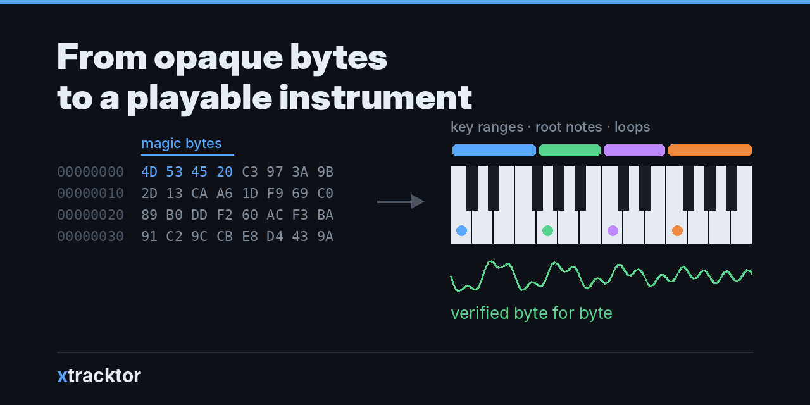
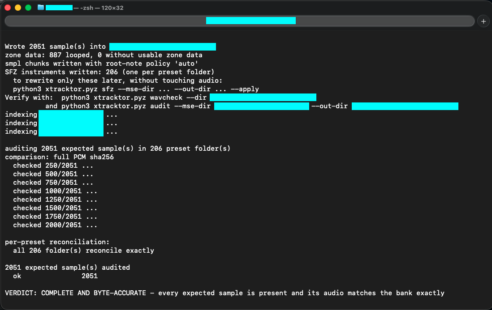
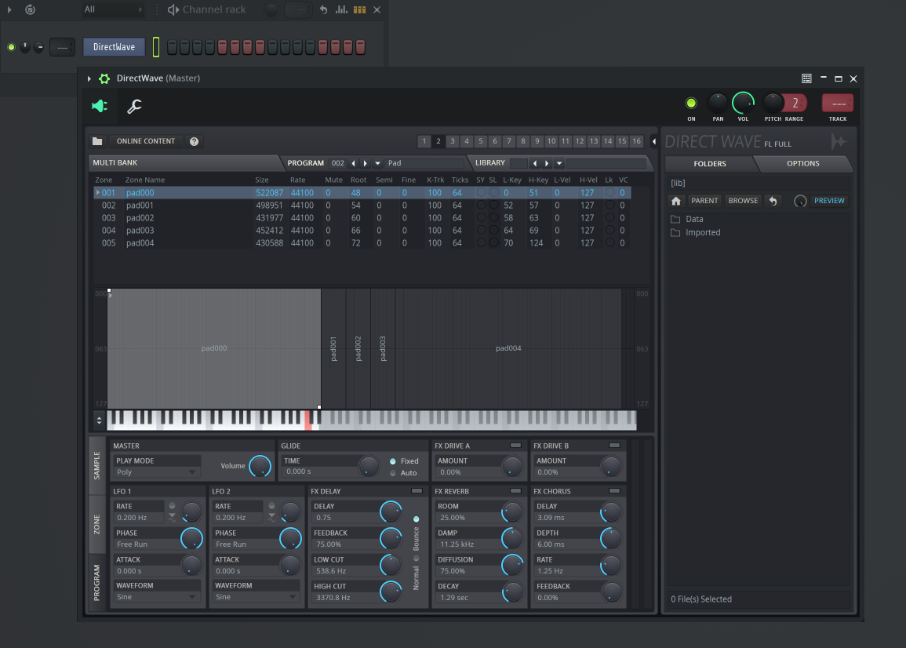

# xtracktor



**Turn `.mse` sample banks into playable SFZ instruments — verified byte for byte.**

[](https://github.com/jsmlndz/xtracktor/actions/workflows/ci.yml)
[](LICENSE)
[](docs/design.md#2-source-layout)

xtracktor is a command-line tool written in Python, using only the standard library. It reads `.mse` banks, and writes one folder of WAV files plus one SFZ instrument per preset. Then it proves the result correct.

## Why

I built the tool because, while working with a plug-in, I noticed the size of the VST was very large, which led me to ask if there were any treasures hidden inside.

## Results

On a commercial sample library (three banks, about 2.4 GB):

- **2,051 samples from 3 banks → 206 preset instruments**, each a folder of WAVs plus one `.sfz`
- **Every sample verified byte for byte** against the bank: the SHA-256 audit reports `COMPLETE AND BYTE-ACCURATE`, 2,051/2,051
- **Every WAV structurally valid**: `wavcheck` reports `ok 2051`
- **Root notes verified by measuring the actual pitch** of the audio: `delta 0` on every pitched preset
- **Plays correctly in DirectWave** (FL Studio), with correct key mapping and pitch

*Extraction and full audit on the commercial library (paths and bank names redacted):*



*An extracted pitched preset in DirectWave (FL Studio): five zones, each with its own key range and root note:*



## Quick start

Download `xtracktor.pyz` from [Releases](https://github.com/jsmlndz/xtracktor/releases). It needs Python 3.9 or newer and nothing else.

```bash
BANKS=/path/to/banks          # folder containing the .mse files
OUT=/path/to/output           # where the instruments will go

python3 xtracktor.pyz verify    --mse-dir "$BANKS"
python3 xtracktor.pyz zonecheck --mse-dir "$BANKS"
python3 xtracktor.pyz extract   --mse-dir "$BANKS" --out-dir "$OUT"            # preview
python3 xtracktor.pyz extract   --mse-dir "$BANKS" --out-dir "$OUT" --apply    # write
python3 xtracktor.pyz audit     --mse-dir "$BANKS" --out-dir "$OUT" --zones
python3 xtracktor.pyz wavcheck  --dir "$OUT"
python3 xtracktor.pyz pitch     --dir "$OUT/<a pitched preset>"
```

Anything that writes files is a dry run until you add `--apply`. The [usage guide](docs/usage.md) walks through every step with example output.

To build from source and run the acceptance tests:

```bash
git clone https://github.com/jsmlndz/xtracktor.git
cd xtracktor
python3 tools/build_pyz.py                           # writes dist/xtracktor.pyz
bash tools/baseline.sh dist/xtracktor.pyz results    # expect 5 × PASS
```

## How it's verified

### Five gates and a portable fingerprint

[`tools/baseline.sh`](tools/baseline.sh) generates a synthetic test bank, runs every command against it and checks five things:

| Check | Command | What it proves |
|---|---|---|
| GATE 1 | `zonecheck` | Every zone block decodes and passes its validity checks |
| GATE 2 | `extract --apply`, then `audit --zones` | Every sample is present and its SHA-256 matches the bank's audio |
| GATE 3 | `pitch` | Each pitched sample's measured pitch matches its stored root note |
| HEALTH | `wavcheck` | Every WAV written is structurally valid |
| MATCH | SHA-256 of the output manifest | Every WAV and SFZ written is identical to the reference |

```
PASS  GATE 1  zone layout parses
PASS  GATE 2  byte-accurate extraction
PASS  GATE 3  roots match measured pitch
PASS  HEALTH  13 structurally ok WAVs
PASS  MATCH   output identical to the reference
```

The test bank reproduces every structural quirk of the real banks and contains no copyrighted audio. It is byte-identical on every machine and Python version, so a single reference fingerprint holds everywhere. CI runs the check on Linux and macOS, with Python 3.9–3.13, on every push.

### A refactor proven by output identity

Version 1.0.0 merged five single-purpose scripts into one CLI. A 58-case differential suite ran the old scripts and xtracktor on identical input, covering every command and flag, sabotaged extractions and deliberately broken WAVs. 56 cases were identical. The other 2 differed because of a deliberate fix: a new `zone-mismatch` count in the audit summary.

### The root-note bug: why byte accuracy isn't enough

One bug passed the byte-for-byte audit completely. The first field of each zone block was misread as a zone index, so the bottom key of each zone's key range was used as the root note instead. Multisampled presets played up to **39 semitones sharp**, with an audible pitch jump at every zone boundary, yet every byte of audio and every zone field checked out as consistent.

Only measuring the audio caught it. `pitch` now estimates each sample's fundamental frequency and compares it with the stored root, and GATE 3 keeps the bug from coming back: with it reintroduced, GATE 2 still passes and only GATE 3 fails. Internal consistency is not correctness.

## Commands

| Command | Purpose |
|---|---|
| `verify` | Parse records, resolve presets, report health. **Run first** |
| `index` | List every sample record |
| `zones` | Probe the zone block statistically, for unfamiliar libraries |
| `zonecheck` | Decode and validate every zone against constraints |
| `extract` | WAVs + `smpl` chunks + one SFZ per preset (dry run unless `--apply`) |
| `audit` | Prove an extraction complete and byte-accurate |
| `sfz` | Rewrite only the `.sfz` files (dry run unless `--apply`) |
| `match` | Identify already-extracted WAVs by their audio |
| `pitch` | Measured pitch vs stored root note |
| `wavcheck` | Diagnose structurally broken WAVs |
| `survey` | Raw string layout of a bank, with offsets |
| `fixture OUT_DIR` | Build the synthetic test bank |

## Requirements and limits

- Python 3.9+, tested on 3.9–3.13. Standard library only. If numpy is installed, `pitch` uses it, with identical results.
- Verified on one commercial sample library (three banks). Other `.mse` libraries, and non-16-bit or FLAC-sourced banks, are untested.

## Documentation

- [Usage guide](docs/usage.md): the full workflow, every command and option, with example output
- [The `.mse` format](docs/format.md): file header, sample records, zone blocks, root-note and preset-grouping rules
- [Design and verification](docs/design.md): architecture, acceptance gates, invariants, verification record and change history
- [Changelog](CHANGELOG.md)

## AI assistance

Built with AI assistance (Claude). I defined the problem, tested every stage against the real sample banks, designed the acceptance checks and decided what shipped.

## Disclaimer

xtracktor is an independent project, not affiliated with or endorsed by any sampler developer or sample-library publisher. It contains no samples. Use it only with libraries you own, and respect their licence terms — most prohibit redistributing extracted samples.

## Credits

[MSE-Extract-Tool](https://github.com/robmurru/MSE-Extract-Tool) (MIT), whose documented per-sample record layout was the starting point. xtracktor extends it with the file header, zone data, preset grouping and root-note rules; see the [comparison](docs/format.md#comparison-with-mse-extract-tool).

## Licence

[MIT](LICENSE) © 2026 Jose Melendez
