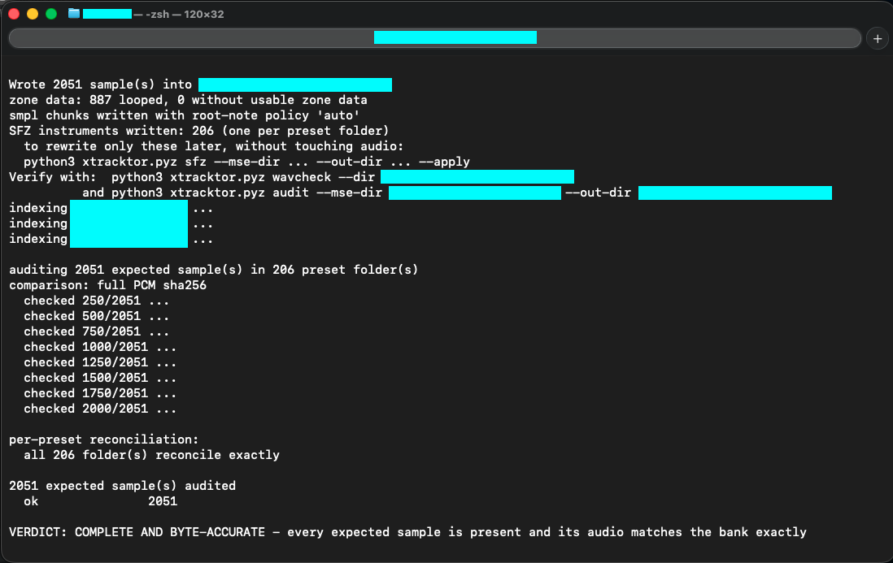
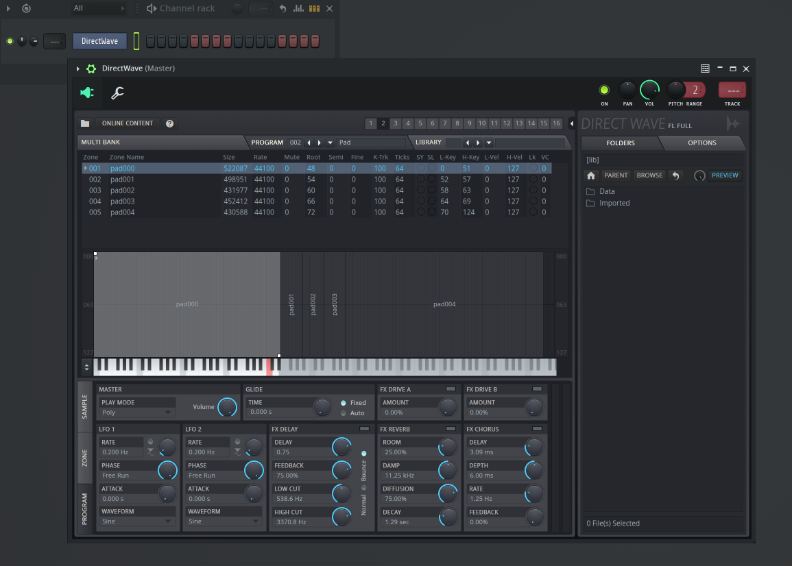
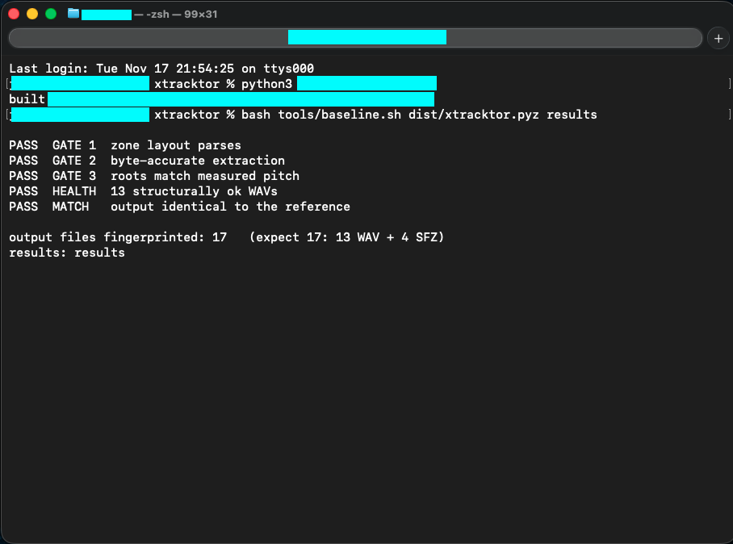

# xtracktor usage guide

[README](../README.md) · **Usage guide** · [Notes](notes.md) · [Design and verification](design.md)

`xtracktor` turns `.mse` sample banks into playable sampler instruments: one folder per preset, containing WAV files and one `.sfz` instrument. It can also prove the result is correct and help you inspect banks you haven't seen before.

This guide covers:
- [**Part 1:**](#part-1-from-mse-banks-to-preset-sfz-instruments) the main workflow, from `.mse` banks to verified preset SFZ instruments.
- [**Part 2:**](#part-2-other-things-xtracktor-can-do) the tool's other abilities, with example commands.
- [**Part 3:**](#part-3-quick-reference) a quick reference.

> **Example output.** Every example below is real output from the built-in test bank (`xtracktor fixture`), a small synthetic `.mse` that reproduces the structure of real banks. On a full commercial library (three banks, 2,051 samples, 206 presets) the same commands produce the same kind of report, just longer.

---

## Before you start

**Requirements:** Python 3.9 or newer (tested on 3.9 through 3.13). Nothing else is needed. If numpy is installed, `pitch` uses it to run faster, with identical results.

**Running it:** download `xtracktor.pyz` from the project's [Releases page](https://github.com/jsmlndz/xtracktor/releases) and run it with Python. To build it from source instead, run `python3 tools/build_pyz.py` in a clone of the repository; it writes `dist/xtracktor.pyz`.

```bash
python3 xtracktor.pyz --help              # list all commands
python3 xtracktor.pyz extract --help      # options for one command
python3 xtracktor.pyz --version
```

**Optional shortcut** (add to `~/.zshrc` or `~/.bashrc`; adjust the path):

```bash
alias xt='python3 /path/to/xtracktor.pyz'
```

**Three habits:**
1. **Quote paths that contain spaces**, e.g. `"…/03-Bell Pad"`.
2. **Anything that writes files is a dry run until you add `--apply`.** Run it once without `--apply` to preview.
3. **Progress lines** (`indexing …`, `checked 250/2051 …`) go to the terminal's error stream. Results go to normal output, so `> report.txt` captures just the report.

---

# Part 1: From `.mse` banks to preset SFZ instruments

Set two variables once per terminal window, so the commands stay short:

```bash
BANKS=/path/to/banks          # folder containing the .mse files
OUT=/path/to/output           # where the instruments will go
```

## Step 1: Check the banks parse

```bash
python3 xtracktor.pyz verify --mse-dir "$BANKS"
```

`verify` reads every bank without writing anything. For each bank it lists:
- the sample records it found
- the audio format
- each preset folder, with its display name and sample count

The left column is the folder inside the bank; the right column is the preset's display name:

```
Test Bank-Q.mse   0.3 MB
sample records: 14     parsed cleanly: 13 / 14
audio: [44100] Hz   [2] ch   [2] bytes/sample
presets (distinct sample folders): 4   with display name: 4

  000-Drum Kit               -> 01-Drum Kit                 5 samples
  23-Bell Pad                -> 03-Bell Pad                 3 samples
  Soft Lead                  -> 23-Soft Lead                3 samples
  24-Bass & Pluck            -> 04-Bass & Pluck             2 samples

records skipped (1):
  BP000.wav        bare filename, not a record; ...

VERDICT: 1 record(s) skipped, 0 preset folder(s) without a display name
```

A skipped bare filename is a metadata reference inside the bank, not audio, so nothing is missing. On a full library, expect every folder to get a display name.

## Step 2: Check the zone data (key ranges, root notes, loops)

```bash
python3 xtracktor.pyz zonecheck --mse-dir "$BANKS"
```

Every sample has a *zone*: which keys and velocities trigger it, its root note, and its loop points. `zonecheck` decodes every zone and tests it against the rules a valid zone must satisfy. Expect `VERDICT: zone layout holds for every record` and exit status 0.

The "sample zones" list shows what each sample will become in the instrument:

```
  01-Drum Kit   DK000.wav  root=0   eff=36  FIXED key=36-36  vel=0-127 loop=2 1200-4799
  01-Drum Kit   DK001.wav  root=1   eff=37  FIXED key=37-37  vel=104-127 loop=0 0-4799
  03-Bell Pad   BP000.wav  root=36  eff=36  pitch key=0-39  vel=0-127 loop=2 2400-9599
  03-Bell Pad   BP001.wav  root=42  eff=42  pitch key=40-45  vel=104-127 loop=0 0-9599
```

- `FIXED` marks a drum or one-shot. It plays at its natural pitch on its key, so its effective root (`eff`) is its own key, not the stored counter (`root`).
- `pitch` marks a pitched sample stretched across a key range around its root note.

## Step 3: Preview, then extract

```bash
# preview: counts, space needed, free-space check - writes nothing
python3 xtracktor.pyz extract --mse-dir "$BANKS" --out-dir "$OUT"

# extract for real
python3 xtracktor.pyz extract --mse-dir "$BANKS" --out-dir "$OUT" --apply
```

**The preview** reports how many samples and preset folders will be written, how much audio that is, and whether there's enough free space. `space check: OK` means there's room plus 256 MB of headroom; without it, `--apply` refuses to start.

**The `--apply` run:**
- It copies every sample's audio out of the banks **byte for byte**. Nothing is re-encoded.
- It adds a `smpl` chunk to each WAV, recording the root note and loop points.
- It writes **one `.sfz` instrument per preset**.

```
Wrote 13 sample(s) into /path/to/output
zone data: 5 looped, 0 without usable zone data
smpl chunks written with root-note policy 'auto'
SFZ instruments written: 4 (one per preset folder)
```

If you press Ctrl-C, or the disk fills, no half-written file is left behind. Just run the same command again.

**The result:**

```
output/
├── 01-Drum Kit/
│   ├── 01-Drum Kit.sfz       <- the instrument: load this
│   ├── DK000.wav
│   ├── DK001.wav
│   └── ...
├── 03-Bell Pad/
│   ├── 03-Bell Pad.sfz
│   ├── BP000.wav  BP001.wav  BP002.wav
└── ... one folder per preset
```

## Step 4: Prove the extraction is correct

```bash
python3 xtracktor.pyz audit --mse-dir "$BANKS" --out-dir "$OUT" --zones
python3 xtracktor.pyz wavcheck --dir "$OUT"
```

**`audit`** goes back to the banks and checks every file:
- It is present where it should be.
- Its audio is the right length.
- Its SHA-256 matches the bank's audio.
- With `--zones`, its root note and loops match the bank.
- No unexpected WAVs are lying around.

On a full library it reads every byte (several GB), so it takes a few minutes. A clean result ends:

```
per-preset reconciliation:
  all 4 folder(s) reconcile exactly

13 expected sample(s) audited
  ok               13

VERDICT: COMPLETE AND BYTE-ACCURATE - every expected sample is present and its audio matches the bank exactly
```

**`wavcheck`** confirms every file is a structurally valid WAV: `13 file(s) checked` / `ok 13`.

On a full library the end of `extract --apply` and the full audit look like this (2,051 samples; paths and bank names redacted):



## Step 5: Prove the root notes against the actual audio

```bash
python3 xtracktor.pyz pitch --dir "$OUT/03-Bell Pad"
```

`pitch` listens to each sample, measures its real pitch and compares it with the root note written in the file. It catches mistakes a byte-accurate audit cannot see:

```
file        note     midi   conf   root   delta  verdict
BP000.wav     C2    36.01  0.833     36       0  matches stored root
BP001.wav    F#2    42.01  0.882     42       0  matches stored root
BP002.wav     C3    48.03  0.918     48       0  matches stored root

3 pitched sample(s) compared with a stored root
  deltas seen: [0]
  VERDICT: every stored root matches the measured pitch
```

Why this matters: an earlier version read the wrong field as the root note, and pitched presets played up to 39 semitones sharp while the byte-for-byte audit still passed. See [Root notes](notes.md#root-notes-should-be-analyzed).

> **Run `pitch` on pitched presets (pianos, synths, pads), not drum kits.** A drum zone deliberately plays at its natural pitch, so its root is the key that triggers it, not the note it sounds. On a kit the deltas are meaningless, and the verdict can wrongly say the roots disagree.

## Step 6: Load an instrument in your sampler

Each preset folder is one instrument. Open its `.sfz` in an SFZ-capable sampler (tested in DirectWave in FL Studio). Keep the `.sfz` in the same folder as its WAVs: it refers to them by filename.

A pitched preset loaded in DirectWave. Each zone's key range and root note come from the SFZ:



**What's inside an SFZ** (a pitched preset):

```
// generated by xtracktor from .mse zone data
// preset: 03-Bell Pad

<group>

<region> sample=BP000.wav
  lokey=0 hikey=39 pitch_keycenter=36 lovel=0 hivel=127 end=9599 loop_mode=loop_continuous loop_start=2400 loop_end=9599

<region> sample=BP001.wav
  lokey=40 hikey=45 pitch_keycenter=42 lovel=104 hivel=127 end=9599 loop_mode=no_loop
```

| Opcode | Meaning |
|---|---|
| `lokey` / `hikey` | The keys that trigger this sample |
| `pitch_keycenter` | The root note: the key where it plays untransposed |
| `lovel` / `hivel` | The velocity range: layers for soft and hard playing |
| `pitch_keytrack=0` | Drum zones only: don't transpose with the key |
| `loop_mode`, `loop_start`, `loop_end` | The sustain loop |

The SFZ matters because a WAV's own `smpl` chunk can only store a root note and loop points. Key ranges and velocity layers live only in the SFZ (see [Why SFZ as well as `smpl`](notes.md#why-sfz-as-well-as-smpl)).

### The whole workflow in one block

```bash
BANKS=/path/to/banks
OUT=/path/to/output

python3 xtracktor.pyz verify    --mse-dir "$BANKS"
python3 xtracktor.pyz zonecheck --mse-dir "$BANKS"
python3 xtracktor.pyz extract   --mse-dir "$BANKS" --out-dir "$OUT"            # preview
python3 xtracktor.pyz extract   --mse-dir "$BANKS" --out-dir "$OUT" --apply    # write
python3 xtracktor.pyz audit     --mse-dir "$BANKS" --out-dir "$OUT" --zones
python3 xtracktor.pyz wavcheck  --dir "$OUT"
python3 xtracktor.pyz pitch     --dir "$OUT/<a pitched preset>"
```

---

# Part 2: Other things xtracktor can do

## 2.1 Look inside a bank before extracting anything

**See the raw layout:** every readable string, with its byte position. `PATH` entries are samples; `NAME` entries are everything else.

```bash
python3 xtracktor.pyz survey "$BANKS/<bank>.mse" --names-only --max 40
```

```
STRINGS  51 total: 14 PATH, 37 NAME
...
0x00000296  NAME  3-4
0x000002b9  NAME  +9-:
0x00000300  NAME  Jm7-7
...
0x0000038f  NAME  01-Drum Kit
```

Entries like `3-4` and `Jm7-7` are fragments of audio data that happen to look like text. A real bank has tens of thousands of them, which is why xtracktor matches preset names to folders by name rather than trusting anything that looks like a heading.

**A spreadsheet of every sample:** preset, original path, rate, channels, length and position in the bank.

```bash
python3 xtracktor.pyz index --mse-dir "$BANKS" --csv samples.csv
```

**A spreadsheet of every zone:** the full key and velocity mapping, before you extract.

```bash
python3 xtracktor.pyz zonecheck --mse-dir "$BANKS" --csv zones.csv
```

Its columns include `preset`, `sample_name`, `root_note`, `effective_root`, `fixed_pitch`, `key_low`, `key_high`, `velocity_low`, `velocity_high` and the loop points. Filter it in a spreadsheet to answer questions like "which presets have velocity layers?".

## 2.2 Investigate an unfamiliar library

Before trusting an extraction of banks from a different library, check whether they follow the same layout:

```bash
python3 xtracktor.pyz verify    --mse-dir /path/to/new/banks
python3 xtracktor.pyz zonecheck --mse-dir /path/to/new/banks
python3 xtracktor.pyz zones     --mse-dir /path/to/new/banks --only-interesting
python3 xtracktor.pyz zones     --mse-dir /path/to/new/banks --filter "piano" --dump 3
```

`zones` analyses the zone block slot by slot across every sample. It shows which positions hold note numbers, positions within the sample, or small flag values. `--only-interesting` hides always-zero slots, `--filter` narrows it to presets or samples whose names contain some text, and `--dump N` prints the raw non-zero values of the first N zones.

If `zonecheck` reports violations, the library's layout differs and should be investigated before extracting.

## 2.3 Extraction variations

| Goal | Add to `extract` |
|---|---|
| Name folders by the bank's internal folder names (`000-Drum Kit`) instead of display names (`01-Drum Kit`) | `--group-by folder` |
| WAVs with root and loop chunks, but no SFZ files | `--no-sfz` |
| Plain WAVs: no `smpl` chunk, no SFZ | `--no-zones` |
| WAVs without `smpl` chunks, still with SFZ | `--no-smpl` |
| For a sampler that rejects `pitch_keytrack` | `--no-keytrack` |
| List more preset folders in the preview | `--max 300` |
| Write even though the space check failed (not recommended) | `--force` |

```bash
# a second copy organised by the bank's own folder names
python3 xtracktor.pyz extract --mse-dir "$BANKS" --out-dir /path/to/by-folder --group-by folder --apply

# audio only, e.g. for a DAW audio library rather than a sampler
python3 xtracktor.pyz extract --mse-dir "$BANKS" --out-dir /path/to/audio-only --no-zones --apply
```

> **Use the same `--group-by` (and `--root-note`) for `audit` and `sfz`** as you used for `extract`. Otherwise they look for files in the wrong places.

**Root-note overrides** (`--root-note keylow|keyhigh|center`) exist for experiments only. The default, `auto`, reads the true root from the bank and is the only setting verified against the audio. Drum zones always use their own key, whatever you choose.

## 2.4 Rebuild only the SFZ files (seconds, audio untouched)

If a sampler needs a different SFZ variant, regenerate just the text files:

```bash
# preview - shows the first SFZ as it would be written
python3 xtracktor.pyz sfz --mse-dir "$BANKS" --out-dir "$OUT" --no-keytrack

# rewrite every .sfz file
python3 xtracktor.pyz sfz --mse-dir "$BANKS" --out-dir "$OUT" --no-keytrack --apply
```

```
Would write 4 SFZ file(s) for 4 preset folder(s)
pitch_keytrack on fixed-pitch zones: omitted (--no-keytrack)

preview of 01-Drum Kit.sfz:
  ...
  <region> sample=DK000.wav
    lokey=36 hikey=36 pitch_keycenter=36 lovel=0 hivel=127 end=4799 loop_mode=loop_continuous ...
```

To go back to the default, run it again without `--no-keytrack`.

## 2.5 Regression test after any change to xtracktor

`xtracktor` carries its own synthetic test bank, reproducing the structural quirks of real banks. [`tools/baseline.sh`](../tools/baseline.sh) builds it, runs the full workflow on it, and compares the result against a fixed fingerprint. From a clone of the repository:

```bash
python3 tools/build_pyz.py
bash tools/baseline.sh dist/xtracktor.pyz results/check-$(date +%Y%m%d)
```

Expect five `PASS` lines. The test bank is identical on every machine and Python version, so the fingerprint is too. [Acceptance gates](design.md#3-acceptance-gates) explains each check.

The build and the five checks on macOS (paths redacted):



To experiment by hand on the test bank:

```bash
python3 xtracktor.pyz fixture /tmp/fx
python3 xtracktor.pyz extract --mse-dir /tmp/fx/banks --out-dir /tmp/fx/out --apply
python3 xtracktor.pyz match   --mse-dir /tmp/fx/banks --wav-dir /tmp/fx/extracted
```

## 2.6 Use it in scripts

Every command sets an exit status, so it can drive scripts:

```bash
if python3 xtracktor.pyz audit --mse-dir "$BANKS" --out-dir "$OUT" --quick > audit.txt; then
  echo "library OK"
else
  echo "problems - see audit.txt"
fi
```

| Exit status | Meaning |
|---|---|
| `0` | Finished; for `audit` and `zonecheck`, also clean |
| `1` | `audit` found problems, `zonecheck` found violations, `extract` failed to write a file or refused for lack of space, or no input files were found |
| `2` | The command line was invalid (unknown option, missing argument) |
| `130` | Interrupted with Ctrl-C (nothing half-written is left) |

The reporting commands (`verify`, `index`, `zones`, `survey`, `match`, `wavcheck`, `pitch`, `sfz`) exit `0` whenever they run, even if what they report is bad. Read their verdict lines instead.

## 2.7 Recovering from accidents

| Situation | What to do |
|---|---|
| Deleted the output folder | Re-run Part 1, steps 3–5. The banks are the source; the result is byte-identical. |
| `audit` shows `audio-mismatch` on many files, or WAVs that are all silence | Usually memory pressure on the machine during the write. Run `extract --apply` again, then `audit`. |
| Interrupted an extraction | Run the same `extract --apply` again. Finished files are rewritten; no partial file was left. |
| A sampler won't load the SFZ files | Try `sfz --no-keytrack --apply` ([section 2.4](#24-rebuild-only-the-sfz-files-seconds-audio-untouched)). Make sure each `.sfz` is next to its WAVs. |
| Stray files in the output | `audit` lists them as `extra`; delete them. |

---

# Part 3: Quick reference

| Command | What it does | Writes files? |
|---|---|---|
| `verify --mse-dir D` | Parse every bank, resolve preset names, report health | No |
| `index --mse-dir D [--csv F]` | List every sample record | CSV only |
| `zonecheck --mse-dir D [--csv F]` | Decode and validate every zone (keys, velocity, root, loops) | CSV only |
| `zones --mse-dir D` | Slot-by-slot analysis of the zone block, for unfamiliar libraries | No |
| `survey FILE_OR_DIR` | Every readable string in a bank, with byte offsets | No |
| `extract --mse-dir D --out-dir O [--apply]` | WAVs + `smpl` + one SFZ per preset | With `--apply` |
| `sfz --mse-dir D --out-dir O [--apply]` | Rewrite only the `.sfz` files | With `--apply` |
| `audit --mse-dir D --out-dir O [--zones]` | Prove an extraction complete and byte-accurate | CSV only |
| `wavcheck --dir W` | Diagnose structurally broken WAVs | CSV only |
| `pitch --dir W` | Measured pitch vs stored root note | CSV only |
| `match --mse-dir D --wav-dir W` | Identify WAVs from another tool by their audio | CSV only |
| `fixture OUT` | Build the synthetic test bank | Yes |

**Options shared across commands:**
- `--csv FILE`: write the full results as a spreadsheet.
- `--max N`: how many lines to print.
- `--group-by preset|folder` and `--root-note auto|…`: must match between `extract`, `sfz` and `audit`.
